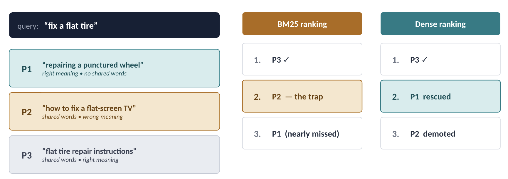
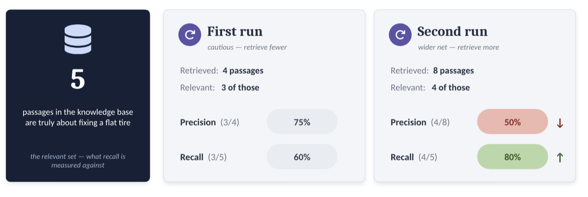

# Retrieval-Augmented Generation (RAG)

Large language models (LLMs) answer from **parametric knowledge**: patterns
stored in their weights during training. That knowledge is fixed at training
time, cannot see your own documents, and gives no sources. Because the model
produces the most *probable* text rather than the most *truthful* text, it can
also make things up ("hallucinate"). 

**Retrieval-Augmented Generation** (RAG) adds **non-parametric knowledge** 
without retraining the model. Documents are first split into chunks and **indexed**. 

For each question, a **retriever** finds the most relevant chunks, 
and a **generator** (the same or another LLM) writes an answer
grounded in those chunks. The result combines the precision of search with the
fluency of an language model. 

The answer can only be as good as what was retrieved, so
retrieval and generation are **evaluated** separately.
This also means that if your retrieval step is not good enough,
your generated results won't be either, no matter how powerful the generative LLM is.

```text
Documents ──► Extraction ──► Chunking ──► Embedding ──► Index   (done once)
                                                          │
Question ──────────────────────────────► Retriever ◄──────┘
                                              │ top-k chunks
                                              ▼
                       Augmented prompt (question + chunks) ──► LLM ──► Answer + citations
```

## When is RAG useful?

- **Dynamic knowledge:** training is expensive and has a cutoff date. If you need domain-specific or the answers to your queries are always evolving, RAG is a good option.
- **Private data:** if you want to use your own private documents but don't want to have to give them to the
  model explicitly, you can keep a local database and only requests summaries to a remote powerful model.
- **Source Attribution:** a plain LLM answer doesn't say where the information came from, with TAG you can always reference to the original chunk(s) that generated an answer.
- **Mitigate Hallucinations:** *probable ≠ truthful.* When the model has a knowledge
  gap, it still writes an answer that sounds as confident as the correct ones. 
- **Long prompts don't scale:** you could paste whole documents into the
  prompt, but accuracy drops as the context grows. In most cases this doesn't even
  work when you have hundreds of documents or many questions.

## How Naive RAG works

These points are taken from lessons learned during the [Portable RAG](https://github.com/MINE-DD/PRAG-AI#readme) eScience project.

### Indexing

- **Document extraction:** convert PDFs and other files to text or Markdown.
  This step is often the bottleneck. Fast tools are less accurate, and
  accurate tools (which also handle tables and figures) are slower.
- **Chunking:** split documents into passages. Each chunk should be large
  enough to carry context and small enough to stay unambiguous. Where to split? Naive chunking + overlap tends to be good enough.
- **Chunk overlap:** consecutive chunks share some text, so ideas aren't cut
  in half at a boundary.
- **Structure-aware chunking:** if the document structure is known (for
  example, paper sections), simple rules based on that structure usually work
  better than costly LLM-based "semantic" chunking.
- **Embeddings:** an encoder model turns each chunk (text passage) into a dense vector, and
  the vectors are stored in a vector database, which is optimized for fast and accurate retrieval. This only needs to happen once
  per collection.

For Document extraction see:
- Document Extractors such as [PyMuPDF](https://pymupdf.io/) (very fast, medium accuracy), [Marker](https://github.com/ffos/marker-accurate-pdf-content-extractor) (slower, more accurate), or [Docling](https://github.com/docling-project/docling) (best accuracy, slow) 
- Visual Language Models such as [Qwen2.5-VL-7B](https://huggingface.co/Qwen/Qwen2.5-VL-7B-Instruct)
- Fine-tuned OCR VLMs such as [SuryaOCR](https://github.com/hemmydev/surya-ocr) or [ChandraOCR v2](https://github.com/akanugan/chandra-ocr)

[LangChain](https://docs.langchain.com/oss/python/integrations/splitters) provides tools for the whole pipeline for indexing. 

Good multi-purpose text embedders are [Nomic](https://ollama.com/library/nomic-embed-text-v2-moe) or [qwen3-embedding](https://ollama.com/library/qwen3-embedding), but dependning on the task there are thousands of models available at [HuggingFace](https://huggingface.co/models?other=embeddings) or [Ollama](https://ollama.com/search?c=embedding).

Lightweight Vector Databases such as [Chroma](https://www.trychroma.com/) for prototypes or [QDrant](https://qdrant.tech/) is a stronger option.

### Retrieval

As said before, the retrieval step is crucial for a good quality RAG. Several techniques from classic information retrieval are still used to achieve good recall of information. Vector Databases like QDrant already have these methods implemented so is a matter of calling them. The most used technique for RAG is hybrid retrieval which combines the strenghts of word embeddings with the specificity of lexical matching (for example with BM25 algorithm):

- **Sparse retrieval (BM25):** matches on exact words, weighted by how often
  they appear (in all chunks) and how rare they are. It is
  good at names, codes and rare terms, but fails when the question and the
  document use different words for the same thing (semantic queries).
- **Dense retrieval:** compares embeddings using cosine similarity. It captures
  synonyms and paraphrases, but it is harder to interpret and can inherit
  biases from its training data.
- **Hybrid retrieval:** combines both and is usually preferred.

Here is a nice comparison of both approaches with a toy example: 


Lexical matching can retrieve irrelevant results with homonyms (a "flat tire" and a "flat tv screen" share the same word but are semantically very different). On the other had, "flat tire" vs "puncture wheel" have zero lexical overlap but are semantically equivalent, this is something the text embeddings will capture for us.

Some of the hyperparameters to keep in mind during the retrieval steps are:

- **Top-k:** how many chunks are passed on to the generator.
- **Re-ranking:** a second, more careful model reorders the candidates to put
  the most relevant chunks first.
- **Metadata filtering:** if you know a lot about your documents (for
  example, year or author), hard filters are cheap and effective.
- **Query transformation:** rewriting the query, or the retrieved chunks,
  with respect to the question can improve results, but it is slow.

### Generation

Once you have a list of grounded passages retrieved from your database, the next step is to generate a sound text that both summarizes the content and more importantly addresses the initial user query. A strong generative LLM is preferred at this step so it can decide which information will satisfy the user best. In a nutshell, these are the components that a good generated answer should have:

- **Augmented prompt:** the top-k chunks are inserted into the prompt for the generation step,
  alongside the original question.
- **Grounding:** the model is instructed to answer *from that context*, not
  from its own memory, even if it considers there is valuable information out there.
- **Citations:** asking the model to cite sources links each claim back to
  a passage, which makes the answer verifiable. For this, we need to provide a recognizable key to traceback the passage to it's source.
- **Retriever dependence:** the answer can only be as good as the retrieved passages. Sometimes a generative model can be asked to first rewrite each passage and how it relates to the question, so it is more useful to compress the knowledge. This involves more costs and latency but depending on the desired accuracy might be mandatory.
- **Prompt templates:** beware: small, local LLMs work best with short, concise instructions. Large LLMs benefit from more detailed prompts.

## Evaluation

- **Retrieval: precision and recall.** Precision is the share of retrieved
  chunks that are relevant. Recall is the share of all relevant chunks that
  were retrieved. Retrieving more chunks usually increases recall but lowers
  precision. If you have a strong generation model, higher recall is preferred, as the model will learn to filter out the irrelevant information when generating the answer.



- **Generation: quality dimensions.** Answers are judged on relevance,
  faithfulness (whether the answer is supported by the context), factuality
  and correctness.
- **Reference-free evaluation:** split the answer into individual claims,
  then have a second LLM score each one ("LLM-as-judge"), for example with
  [RAGAS](https://docs.ragas.io/en/latest/getstarted/rag_eval/#basic-setup).
- **Reference-based evaluation:** compare the answer to a gold-standard
  answer using semantic similarity or overlap metrics such as BLEU, ROUGE or
  exact match.
- **Human spot-checks:** people review a representative sample of answers
  for faithfulness and helpfulness.

## Limitations and failure modes

- **Context ignored:** the model falls back on its own memory instead of the
  retrieved context.
- **Incomplete answers:** parts of the answer are missing, or passages are
  combined incorrectly.
- **Retrieval misses:** if the relevant chunk isn't retrieved, the generator
  can't recover it.
- **Hard question types:** some questions need more than finding a single
  passage. Examples include summarising across many documents (global
  context), resolving contradictions between sources, multi-step ("multi-hop")
  reasoning, and counting or aggregating over tabular data.
- **More advanced systems:** agentic RAG pipelines such as
  [PaperQA](https://arxiv.org/abs/2312.07559) handle these questions better,
  but they need large models and many LLM calls per question.
- **Narrow scope works best:** the most reliable RAG applications target one
  specific task rather than general-purpose question answering.


